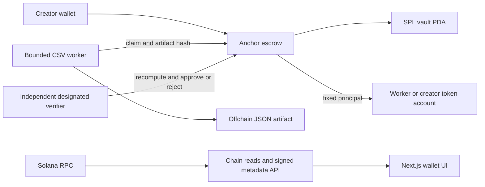

# Architecture

Custody is entirely onchain. Hosted mode stores metadata in SQLite with WAL and full synchronous commits, and immutable CSV/artifact/receipt files on the same persistent volume. The earlier local mode retains atomic JSON. Neither store can authorize escrow transfers or override chain status. Concurrent reads coalesce; hosted job snapshots may reuse a successful read for at most750ms with its observation time exposed. Observed RPC errors invalidate reuse and return an explicit failure. Finalized transaction decoding is cached with bounded capacity while signature lists are reread. Lifecycle labels bind to the IDL's named job account. The SDK is typed from the generated Anchor IDL.

The job PDA uses `job`, creator and a little-endian u64 ID as seeds. The vault PDA uses `vault` and the job address. Standard SPL Token is supported. Job accounts commit specification, acceptance, artifact and verification receipt hashes; large content remains offchain. Amounts use integer token base units.

The worker runs a fixed trusted executable in a child process with Node permission restrictions, a 64 MiB V8 heap setting, a two-second wall limit, at most 1 MiB of input, 10,000 data rows and 64 columns. It evaluates no job-supplied code or instructions. Hosted inputs map exact owned immutable hash URLs directly to checked persistent files, without marketplace-controlled DNS or redirects. Legacy network ingestion remains limited to allowlisted literal-IP origins and rejects private networks except explicitly enabled loopback. Node permission mode restricts filesystem and process operations; it does not provide OS network isolation.

The verifier downloads original input and exact committed artifact bytes. Its own parser and calculation check schema, hashes, numeric summaries and threshold anomalies. The designated wallet signs approval or rejection. Approval enables program settlement; it is the trusted verifier's decision, not a cryptographic proof of arithmetic.

The hosted supervisor restarts failed roles with bounded backoff and observes their
heartbeats. Worker and verifier share trusted host storage and a Unix UID but use
different signers; the CSV child cannot read their keys. Verified jobs automatically
settle to the assigned worker's ATA. A devnet-only capped faucet journals one atomic
SOL/custom-token grant per wallet before broadcast, using exclusive installation,
SQLite reservations and a single active API lease. The browser uses a same-origin
proxy and scoped nonce/domain/body-bound wallet messages. Each guarded custody
signature rechecks RPC genesis. A separate explicit mainnet profile cannot inherit
devnet identities or enable the devnet faucet.
