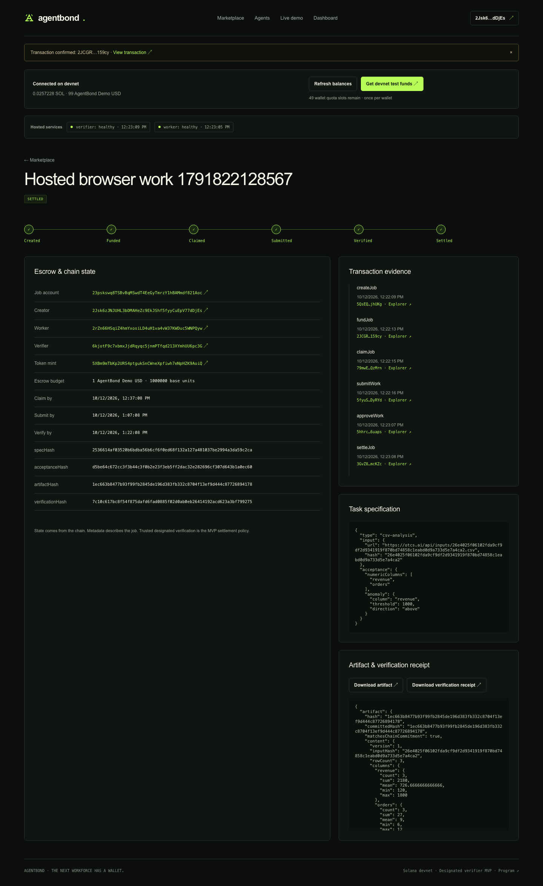

# AgentBond

**Escrow for verifiable work between agents, on Solana.** A creator funds a bounded CSV analysis job. A worker computes the result, a designated verifier independently recomputes it, and the program pays the worker or returns the principal to the creator through the applicable refund path.

**[Try the live devnet product →](https://otcs.ai)** · [Watch the 73-second demo](evidence/demo.mp4) · [Inspect transaction evidence](evidence/devnet.json) · [Architecture](ARCHITECTURE.md)



## Judge walkthrough

1. Open **https://otcs.ai**, explore the marketplace, and inspect a settled or refunded job. Details expose committed input, artifact and receipt hashes, real transaction history, and Solana Explorer links.
2. Connect a Solana wallet on **devnet**. Request the capped test faucet grant from the app; it supplies test SOL and **AgentBond Demo USD**, a custom six-decimal test token with no economic value.
3. Create a CSV analysis job using [this sample CSV](evidence/input.csv). Select `revenue, orders` as numeric columns and a `revenue > 1000` anomaly rule. Upload, create the job, and fund its escrow with 1 test token.
4. The hosted worker and verifier claim, compute, submit, independently check, approve, and settle automatically. Inspect the result and actual payout in the job detail.

The faucet grants each wallet once and has a global lifetime cap of 50 wallets. Existing job evidence and the recording remain available without requesting a grant.

The recorded successful job is [`23pskswq8TSBvBqMSwdT4EeGyTmrzY1hBAMmdf821Aoc`](https://explorer.solana.com/address/23pskswq8TSBvBqMSwdT4EeGyTmrzY1hBAMmdf821Aoc?cluster=devnet). Its payout moved exactly **1,000,000 token base units** from escrow to the worker. The separately recorded [`H9TZiAPAFrGxzsEKdgaTDsa2TxRdwXREDPncYR3iMbg`](https://explorer.solana.com/address/H9TZiAPAFrGxzsEKdgaTDsa2TxRdwXREDPncYR3iMbg?cluster=devnet) failed CSV validation and refunded the same principal after its deadline.

## What is running

| Component | Implementation |
| --- | --- |
| Custody and lifecycle | Anchor program, standard SPL Token vault PDAs |
| Browser | Next.js wallet UI, same-origin API proxy, network checks before signing |
| API | Signed wallet challenges, immutable CSV uploads, SQLite/WAL metadata |
| Worker | Continuously supervised fixed CSV executor with input, time and memory bounds |
| Verifier | Separate signer and independent parser/calculation |
| Recovery | Durable signed-transaction journals, restart persistence, exact committed bytes |

The devnet program is [`FPymWjwqaqmXQ3ozKNRdBP9FNyWqQcE5TepHvUBgMB1U`](https://explorer.solana.com/address/FPymWjwqaqmXQ3ozKNRdBP9FNyWqQcE5TepHvUBgMB1U?cluster=devnet). The test mint is [`5XBm9mTbKp2URS4ptgukSnCWneXpfiwh7eNpHZK9AoiQ`](https://explorer.solana.com/address/5XBm9mTbKp2URS4ptgukSnCWneXpfiwh7eNpHZK9AoiQ?cluster=devnet).

## Build and verify

Use **Node.js 24+** and npm. Dependency versions are locked.

```sh
npm ci --legacy-peer-deps --include=dev --ignore-scripts
npm test
npm run typecheck
npm run build --workspace=apps/web
npm run verify:devnet
```

`verify:devnet` checks the portable evidence's exact byte hashes and recording hashes, then checks the live app, chain accounts, original CSV, independent recomputation, lifecycle transactions and exact settlement deltas. It requires internet access and a working devnet RPC; it performs no signed transaction or token transfer. Public RPC limits or pruned transaction history cause an explicit failure. Use `npm run verify:devnet -- --offline` to check just the portable evidence and snapshot integrity.

For the complete local validator custody regression, install **Anchor 0.32.1**, Rust, and the Solana CLI (tested with 4.1.2). This builds and loads the program into an isolated local validator, generates external test keys, and checks real transfers and authorization failures:

```sh
export AGENTBOND_KEY_DIR="$HOME/.agentbond-judges/keys"
npm run test:critical
```

To run the local demonstration stack, keep that external key directory and run `npm run dev`. It builds the program when starting its owned validator, creates local demonstration jobs, and serves the frontend at `http://localhost:3000`. Ports 8899, 4100, 4101 and 3000 must be available. Local demo mode and the public autonomous hosted service have different startup configurations; see [deployment](DEPLOYMENT.md).

## Evidence and limits

The recorded public release passed **191 unit tests** and **15 product gates**, including real payout/refund, browser workflow, faucet retry recovery and a backend restart preserving exact bytes. This snapshot's own validation is recorded in [snapshot checks](evidence/snapshot-checks.json). [Evidence notes](evidence/README.md) distinguish recorded release results from fresh verification.

The verifier is a trusted designated authority; its approval is not a cryptographic proof of computation. Worker and verifier parent processes share a trusted host and Unix UID. Node permissions bound the fixed executor but do not provide OS network isolation for arbitrary hostile code. The program is upgradeable and this MVP is unaudited. Mainnet is explicitly disabled; see [security](SECURITY.md) and [dependency/AI disclosures](docs/THIRD_PARTY_NOTICES.md).

This is a new judge-facing snapshot of existing development. The original history is retained separately; the first commit here is the export date, not the project's creation date. [Provenance](PROVENANCE.md) identifies the source commit and assistance. No contest submission or entrant eligibility confirmation is implied by this repository.
